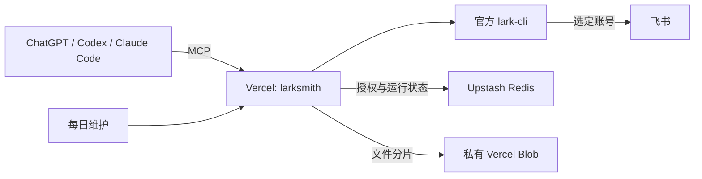

# larksmith

**在 Vercel 上免费自托管，让 Agent 直接使用你的飞书。**

larksmith 将官方 **lark-cli** 封装为远程 MCP 服务，连接 ChatGPT、Codex、Claude Code
等 Agent。部署一次，就能读写飞书文档、表格、消息和日历，查看图片、上传文件，
并按任务切换多个飞书账号。

## 亮点

- **免费方案自托管**：使用 Vercel Hobby、Upstash Redis Free 和 Vercel Blob 免费额度运行。
- **多账号切换**：集中连接多个飞书账号，每次调用通过账户别名选择执行身份。
- **通用 CLI 能力**：从官方 CLI 元数据生成命令目录，Agent 自行发现参数、读取帮助并执行任务。
- **图片与文件互通**：直接返回图片，支持客户端附件、文件上传下载和分块传输。
- **集中管理授权**：OAuth 登录、令牌自动续期、写入回执和每日清理都由服务端处理。
- **轻量客户端**：各端只需连接同一个 MCP 地址，CLI 运行在 Vercel 上。

## 开始使用

1. 按 [部署指南](docs/deployment.md) 创建 Vercel 项目、连接 Upstash 与 Blob，配置飞书应用和账号别名。
2. 部署服务，在 MCP 客户端添加 `https://你的域名/mcp`，完成登录和连接授权。
3. 用 `lark_connect_account` 完成各账号的飞书授权。
4. 告诉 Agent 要完成的任务和使用的账号，例如读取文档、整理表格或上传附件。

免费部署使用 [Vercel Hobby](https://vercel.com/docs/plans/hobby)、
[Upstash Redis Free](https://upstash.com/pricing/redis) 和
[Blob 免费额度](https://vercel.com/docs/vercel-blob/usage-and-pricing)。

## 工作方式



Agent 通过 `lark_cli_catalog` 发现命令、`lark_cli_help` 读取帮助，再用
`lark_cli_read` 或 `lark_cli_write` 执行。图片和文件工具负责传输实际内容，
账户别名贯穿每次调用。详细用法见 [Agent 使用指南](docs/bridge.md)。

## 本地开发

使用 Node.js 24：

```sh
npm ci --ignore-scripts
npm run typecheck
npm test
BRIDGE_ISSUER=https://mcp.example.com npm run build
npm run release:check
```

测试使用合成数据。构建会校验并打包官方 Linux CLI，生成 Vercel Build Output；
GitHub Actions 自动完成测试、构建和 Linux 运行检查。

- [部署与配置](docs/deployment.md)
- [Agent 使用指南](docs/bridge.md)
- [运维与用量](docs/operations.md)
- [版本升级](docs/upgrade.md)
- [安全](SECURITY.md) · [贡献](CONTRIBUTING.md) · [发布检查](docs/releasing.md)

源码采用 [MIT](LICENSE)。官方 CLI 及第三方依赖的归属见 [NOTICE](NOTICE)。
